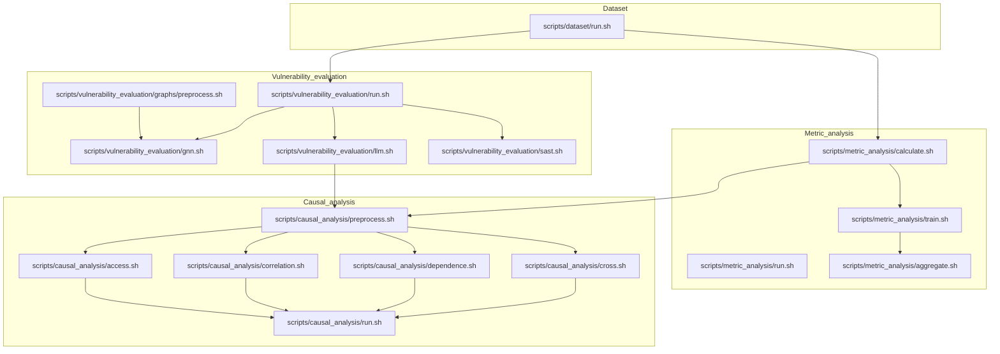

# Reproducibility: Apptainer, Slurm, and scripts

## Conventions

- Run all shell scripts with the **repository root as the current working directory** (interactive or Slurm).
- Inside Apptainer the same path is used as on the host (default mount of the current working directory). Wrappers set `PYTHONPATH="${PWD}/src"`. **No `pip install`** of the repo is required.
- Python entrypoints are **one module per command**: `python -m <module> ...` (see tables below). Some modules use **argparse subcommands** (e.g. `graph.datasets.primevul preprocess|write-sources|add-graphs`).

## Building images (from repo root)

```bash
./scripts/build.sh   # or manually:
apptainer build dataset.sif dataset.def
apptainer build container.sif container.def
apptainer build auto.sif auto.def
apptainer build gnn-preprocessing.sif gnn-preprocessing.def
apptainer build gnn-training.sif gnn-training.def
```

Requirements files consumed at build time: `llm-requirements.txt`, `auto-requirements.txt`, `dataset-requirements.txt`, `gnn-requirements.txt`, `gnn-requirements-preprocess.txt`, `gnn-extra-requirements.txt`.

## Runtime environment

| Variable | Purpose |
|----------|---------|
| `GNN_PREPROCESS_SIF` | Joern/CPG CPU image (default `./gnn-preprocessing.sif`) |
| `GNN_TRAINING_SIF` | PyTorch/PyG GPU image (default `./gnn-training.sif`) |
| `HF_HOME`, etc. | Hugging Face cache; load via `huggingface.env` (sourced from `scripts/config.sh`) |

Helper: `. scripts/lib/run_in_sif.sh` defines `run_in_sif` / `_cheetah_run`:

```bash
. scripts/apptainer_cheetah.sh
_cheetah_run --nv --env-file huggingface.env container.sif python -m llm.finetune_bertlike ...
```

## Images ↔ `python -m` modules (typical)

| Image | Modules (representative) |
|-------|---------------------------|
| `gnn-preprocessing.sif` | `graph.cpgtools.preprocess.parse`, `graph.cpgtools.preprocess.export`, `graph.datasets.primevul write-sources` |
| `gnn-training.sif` | `graph.datasets.primevul` (`preprocess`, `add-graphs`), `graph.train`, `graph.evaluate`, `graph.collect` |
| `container.sif` | `llm.finetune_*`, `llm.eval_*`, `llm.aggregate_results`, `llm.add_predictions`, `llm.add_embeddings`, `llm.cross_information`, `metrics.calculate`, `causal_analysis.access`, `causal_analysis.cross`, `causal_analysis.correlation`, `causal_analysis.dependence`, `causal_analysis.access_per_model`, `dataset.dataset`, `sast.data`, `sast.scores`, `sast.classify` (when not using external `sast.sif`) |
| `auto.sif` | `metrics.train`, `metrics.isolation`, `metrics.leaveoneout` |
| `dataset.sif` | `dataset.dataset`, `sast.data` |

## Shell script dependency graph

High-level order for end-to-end experiments:



- `scripts/run.sh` chains `metric_analysis/run.sh` and `causal_analysis/run.sh`.
- Optional Slurm entrypoints live next to the same scripts (embedded `#SBATCH` headers) or under `scripts/slurm/` (thin wrappers).

## Slurm

Submit jobs **from the repository root** so `SLURM_SUBMIT_DIR` is the project tree the scripts expect (same as interactive use), e.g.:

```bash
sbatch scripts/slurm/wrapper_example.sbatch
```

See `scripts/slurm/wrapper_example.sbatch` for a minimal pattern (`cd "${SLURM_SUBMIT_DIR}"` then call an existing script).
