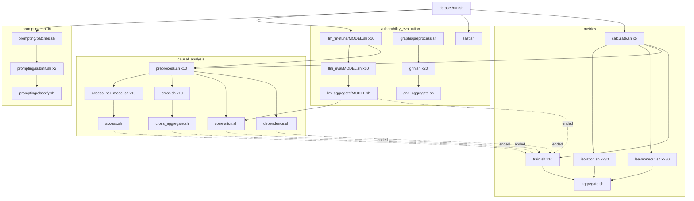

# Reproducibility: Apptainer, Slurm, and scripts

Known deviations from the paper setup and open issues are listed in [reproduction-report.md](reproduction-report.md).

## Conventions

- Run every script with the **repository root as the current working directory**.
- `scripts/config.sh` defines all shared settings: paths, images, the dataset name and the list of the five LLMs. `src/paths.py` assumes the same layout (data in `<repo>/data`).
- Each step is `python -m <module> ...` inside an image, started through `_cheetah_run` (`scripts/lib/run_in_sif.sh`), which sets `PYTHONPATH="${PWD}/src"`. The repository is not installed into the images.
- Stage scripts carry their own `#SBATCH` header and handle exactly one array task (`SLURM_ARRAY_TASK_ID`, default 0). They are submitted through `submit` (`scripts/lib/submit.sh`), which adds job dependencies and creates the log directories.

## Building

```bash
git submodule update --init
./scripts/build.sh
```

Builds `.sif/{llm,metrics,cpgtools,gnn}.sif` from the `.def` files in the repository root, downloads PrimeVul to `data/primevul/raw/`, the PDBERT checkpoint to `data/pdbert/`, and builds the SAST tool images from `sast/`, the git submodule [mlsec-group/sast](https://github.com/mlsec-group/sast) (`build.sh` stops if it is not initialised). Steps whose result exists are skipped. Pip requirements are in `src/<package>/*-requirements.txt`.

## Running

```bash
./scripts/run.sh                          # everything
./scripts/run.sh metrics causal_analysis  # selected experiments
slurm=0 ./scripts/run.sh dataset          # in this shell, without Slurm
DRY_RUN=1 ./scripts/run.sh                # print the submissions
CHEETAH_ARRAY=0-0 ./scripts/run.sh ...    # restrict every array job to this range
```

Experiments: `dataset`, `vulnerability_evaluation`, `metrics`, `causal_analysis`, and `prompting`, which runs only when named: it submits paid requests to the OpenAI Batch API and needs `OPENAI_API_KEY` in the environment and internet access (`OPENAI_API_KEY=… ./scripts/run.sh prompting`; on a cluster whose compute nodes are offline, with `slurm=0` on a login node). An experiment that is not selected is assumed to be finished. Results are printed in the Slurm logs of the aggregate jobs under `data/logs/<job>/`.

A single stage: `sbatch scripts/metrics/calculate.sh` (create its log directory first) or, without Slurm, `SLURM_ARRAY_TASK_ID=3 bash scripts/metrics/calculate.sh`.

## Stage graph



Solid arrows: the later job starts only if the earlier one succeeded. Dotted arrows: `metrics/train.sh` waits until those jobs have ended, because it writes into the model directories they read (see the report, P4).

## Images and modules

| Image | Modules |
|-------|---------|
| `llm.sif` | `dataset.dataset`, `llm.*`, `metrics.calculate`, `causal_analysis.*`, `sast.*`, `prompting.*` |
| `metrics.sif` | `metrics.train`, `metrics.isolation`, `metrics.leaveoneout`, `metrics.aggregate` |
| `cpgtools.sif` | `graph.cpgtools.preprocess.parse`, `graph.cpgtools.preprocess.export` |
| `gnn.sif` | `graph.datasets.primevul` (`preprocess`, `write-sources`, `add-graphs`), `graph.train`, `graph.evaluate`, `graph.collect` |

## Data layout

```
data/primevul/
  raw/primevul_{train,valid,test}.jsonl      build.sh
  hf/                                        dataset.dataset
  mcpp-<model>/                              metrics.calculate
    autosklearn-model-{isolation,leaveoneout}/   metrics.isolation, metrics.leaveoneout
  hf-model/<model>/<uid>/checkpoint-*/       llm.finetune_*; results.json, predictions.json from llm.eval_*
    .../checkpoint-*/embedded/               llm.add_embeddings
    autosklearn-model-10min/                 metrics.train
  <model>/<uid>/checkpoint-*/                llm.add_predictions
  gnn/{raw,hf,sources,cpg_parsed,cpg_json,hf_graphs,runs/seed-<n>/<gnn>}/
  sast/
  prompting/{raw-batches,batches,cache,out}/ prompting.*
data/primevul-lookaround/                    not created by this repository
data/pdbert/                                 build.sh
```

`<model>` is the Hugging Face id with `/` replaced by `__`; the local PDBERT checkpoint is `data__pdbert`.

## Checks

- `scripts/dev/check_python_frozen.sh` fails if experiment code under `src/` differs from the baseline commit without an approved entry in `scripts/dev/approved_patches.txt`.
